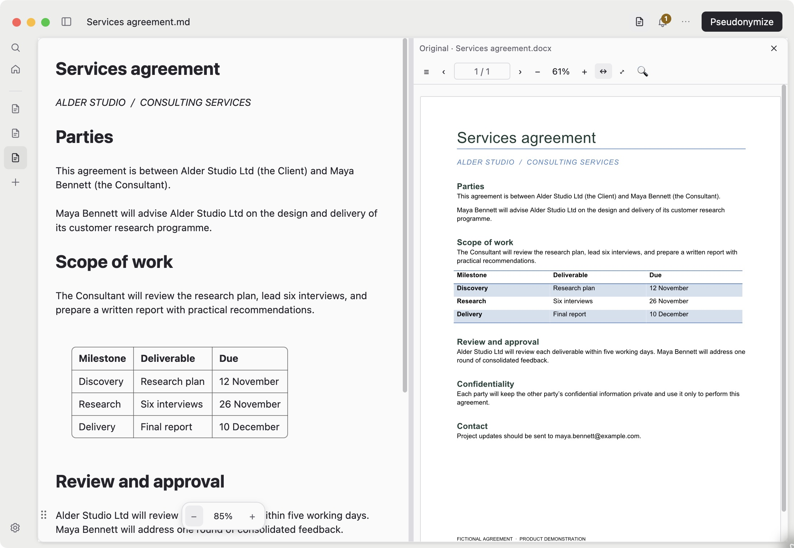
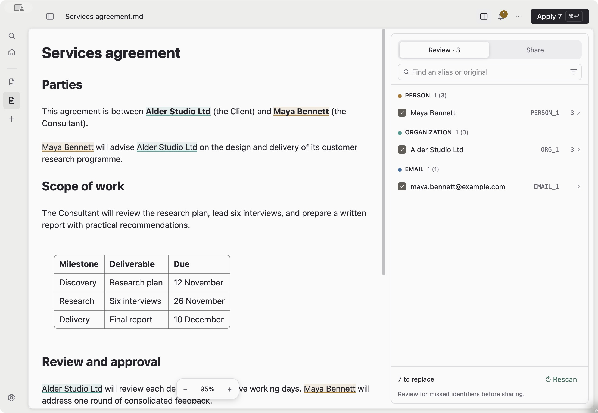
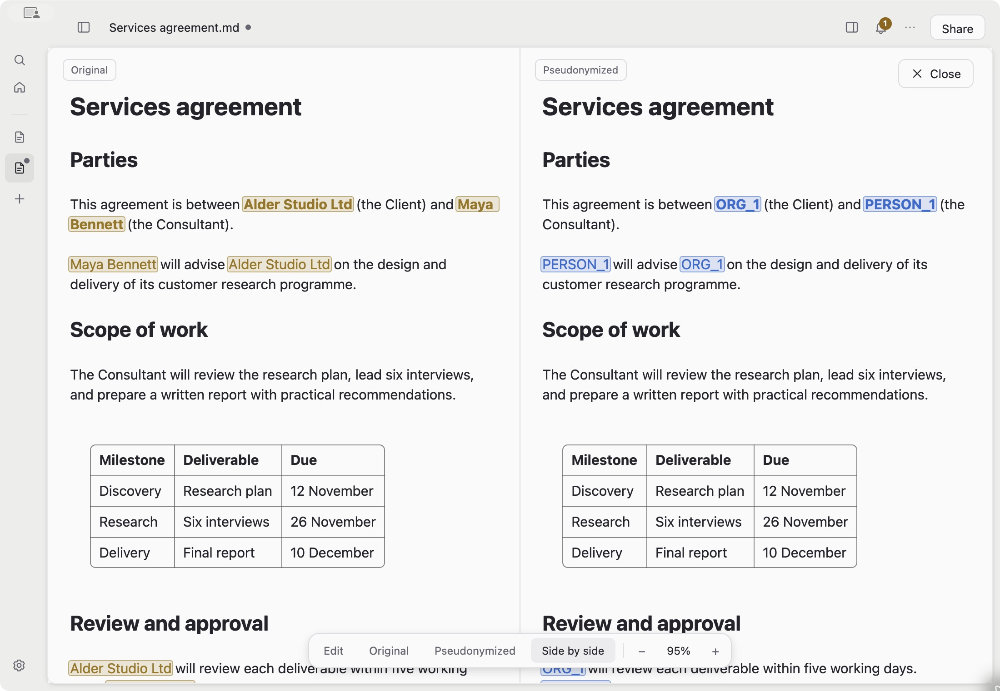

<h1 align="center">
  
   
  mdoc
</h1>

Prepare legal documents for AI, privately, on your own computer.

  <picture>
    <source media="(prefers-color-scheme: dark)" srcset="docs/images/source-dark.jpg">
    
  </picture>

mdoc turns PDFs (including scans), Word and other office documents into
editable Markdown, and replaces client names and other identifying details
with consistent aliases before you paste the text into ChatGPT or Claude.
Your documents never leave your computer. [Learn more](https://lawkitt.com/mdoc/).

  <picture>
    <source media="(prefers-color-scheme: dark)" srcset="docs/images/review-dark.jpg">
    
  </picture>

  <picture>
    <source media="(prefers-color-scheme: dark)" srcset="docs/images/compare-dark.jpg">
    
  </picture>
   
  Original wording and applied aliases, side by side. Fictional demonstration document.

[Watch the product walkthrough](https://lawkitt.com/mdoc/#demo-title) ·
[Light and dark screenshots](docs/product-media/README.md)

## Installation

<h3>
  <picture>
    <source media="(prefers-color-scheme: dark)" srcset="docs/images/apple-dark.svg">
    
  </picture>
  macOS
</h3>

Download `mdoc_<version>_arm64.dmg` from [Releases](https://github.com/lawkitt/mdoc/releases).
Requires a Mac with Apple silicon and macOS 11 or later.

<h3>
  <picture>
    <source media="(prefers-color-scheme: dark)" srcset="docs/images/windows-dark.svg">
    
  </picture>
  Windows
</h3>

Download `mdoc_<version>_x64-setup.exe` from [Releases](https://github.com/lawkitt/mdoc/releases).
Requires Windows x64.

The installer is not signed yet. If Microsoft Defender SmartScreen appears,
select **More info**, then **Run anyway**.

> [!WARNING]
> Pseudonymization finds most identifying details, not all of them. Review the
> whole document before you share it. See [privacy and limitations](docs/privacy.md).

#### License

Licensed under the <a href="LICENSE">GNU General Public License, Version 3.0
or later</a>. Third-party licenses and attribution:
<a href="THIRD-PARTY-LICENSES.html">THIRD-PARTY-LICENSES.html</a>.

