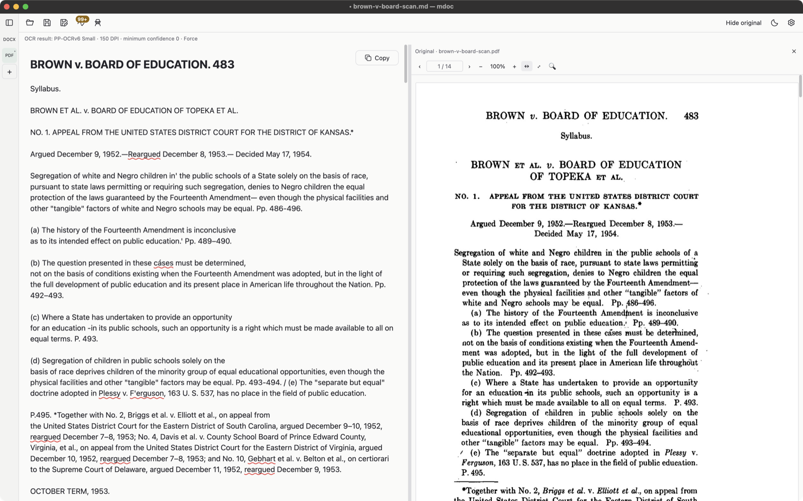
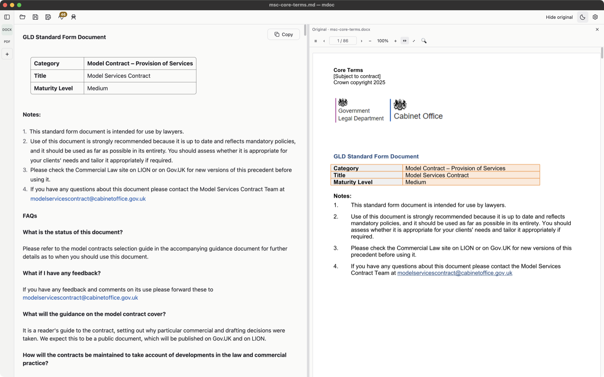

# mdoc

[](https://github.com/lawkitt/mdoc/actions/workflows/ci.yml)
[](https://github.com/lawkitt/mdoc/releases)
[](LICENSE)

Prepare legal documents for AI tools such as ChatGPT or Claude, on your own
computer. mdoc turns PDF (including scans), Word and other office documents into
editable Markdown, and replaces client names and other identifying details with
consistent aliases before you copy the text anywhere.
Product overview: [lawkitt.com/mdoc](https://lawkitt.com/mdoc/).

<picture>
  <source media="(prefers-color-scheme: dark)" srcset="docs/images/pdf-scan-dark.png">
  
</picture>

## What it does

- **Converts documents to Markdown:** PDF, Word (DOC, DOCX), Excel (XLS, XLSX),
  PowerPoint (PPT, PPTX), OpenDocument (ODT, ODS, ODP), RTF, EPUB and CSV, plus
  Markdown and plain text. Headings, lists and tables are kept; page layout is
  not.
- **Recognizes scanned PDFs** locally, in English or English and Russian.
- **Shows the original beside the Markdown** for PDF and Word files, so you can
  check and edit the result. The original file is never changed.
- **Pseudonymizes:** proposes aliases (`PERSON_1`, `ORG_1`, `EMAIL_1`) for
  people, organizations, addresses, emails, phone numbers and other identifiers.
  You review each proposal, add what it missed, and apply the replacements
  yourself. The same person always gets the same alias.
- **Copy Markdown** puts the prepared text on the clipboard to paste into an AI
  tool; **Save** writes it as a `.md` file.

<picture>
  
</picture>

> [!WARNING]
> Pseudonymization finds most identifying details, not all of them. Dates,
> amounts and context are not replaced and may still identify the parties.
> Review the whole document before you share it; mdoc does not guarantee that
> the result is anonymous.

<picture>
  <source media="(prefers-color-scheme: dark)" srcset="docs/images/docx-dark.png">
  
</picture>

<sub>UK Model Services Contract, Crown copyright, licensed under the
[Open Government Licence v3.0](https://www.nationalarchives.gov.uk/doc/open-government-licence/version/3/).</sub>

## Install

Download the latest build from [Releases](https://github.com/lawkitt/mdoc/releases):

| Computer | File |
| --- | --- |
| Mac with Apple silicon (M1 or later) | `mdoc_<version>_arm64.dmg` |
| Windows x64 | `mdoc_<version>_x64-setup.exe` (stable releases also have an `.msi` for managed deployment) |

Builds are not signed with a paid certificate yet, so the first launch needs
one extra step:

- **macOS:** open mdoc once and close the warning, then go to **System Settings
  → Privacy & Security** and click **Open Anyway** next to the message about
  mdoc.
- **Windows:** in the SmartScreen dialog choose **More info → Run anyway**.

The Windows installer also installs the Microsoft Visual C++ Redistributable
(x64) when it is missing; text recognition and pseudonymization need it. The
`.msi` requires it to be installed first.

To check a download, compare it with `SHA256SUMS` from the release, or verify
where it was built:

```sh
gh attestation verify <file> -R lawkitt/mdoc
```

## Privacy and network

Your documents never leave your computer. Opening, converting, recognizing and
pseudonymizing all run locally. mdoc goes online only for:

- **Model downloads**, after you approve them: the text recognition runtime and
  models from GitHub, and the pseudonymization model from Hugging Face. Each file
  is checked against a pinned SHA-256 digest. After that mdoc works offline.
- **The update check** at startup: one anonymous request to the GitHub Releases
  API, carrying no document data. A dot on the Settings button tells you when a
  newer release exists; mdoc never downloads or installs it. Turn the check off
  in **Settings → Updates**.

Text reaches an AI tool only when you paste it there yourself, and that tool's
own data terms then apply.

## Limitations

- **Copy Markdown** copies the current text, including unsaved edits.
- Aliases are not saved: the mapping from aliases back to the originals lasts
  only while the document is open.
- The pseudonymization detector misses some details, especially in Russian text
  and in hidden parts of a source document; see the
  [qualification results](tests/fixtures/pseudonymization/README.md).
- Recognition can misread characters and does not read handwriting; check names
  and figures against the original. See the
  [recognition notes](tests/fixtures/ocr-qualification/README.md).
- Images inside Word files are not recognized; only PDFs are.
- Embedded images are not carried into the Markdown, and complex tables may
  need correction.
- Text recognition and pseudonymization run on Apple silicon Macs and Windows
  x64 only. Intel Macs, Windows on ARM and Linux can build mdoc from source and
  read documents with built-in text.

What is planned next is in the [roadmap](ROADMAP.md).

## Build from source

All dependencies, including the pinned AnyDoc converter, are public.

```sh
git clone https://github.com/lawkitt/mdoc.git
cd mdoc
cargo run
# Or open a document:
cargo run -- path/to/document.pdf
```

## Development

Development commands are [just](https://just.systems) recipes; CI runs the
same ones. `just setup` installs the pinned tools, `just doctor` checks them.

```sh
just check      # fmt, cargo-deny, clippy and tests, as CI runs them
just check-all  # plus the OCR and installed-model smoke tests (downloads)
```

See the [development notes](docs/development.md) for the full recipe list,
fixtures, performance probes, packaging and releases.

## Project documentation

- [Roadmap](ROADMAP.md): status, next steps and deferred work.
- [Glossary](CONTEXT.md): product and code terminology.
- [Architecture decisions](docs/adr/): accepted behavior and its rationale.
- [Evidence](docs/evidence/): measurements and verification records.
- [Production readiness](docs/design/pseudonymization-production-readiness.md):
  open qualification gates.

## License and attribution

mdoc is derived from [Zorite](https://github.com/packetThrower/zorite).
The app is [GPL-3.0-or-later](LICENSE); internal workspace crates retain
their MIT licenses and original copyright notices. See [NOTICE.md](NOTICE.md)
for provenance and [THIRD-PARTY-LICENSES.html](THIRD-PARTY-LICENSES.html) for
dependency licenses.
