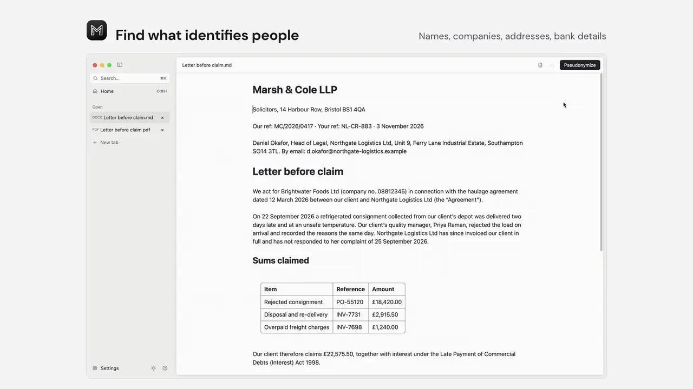
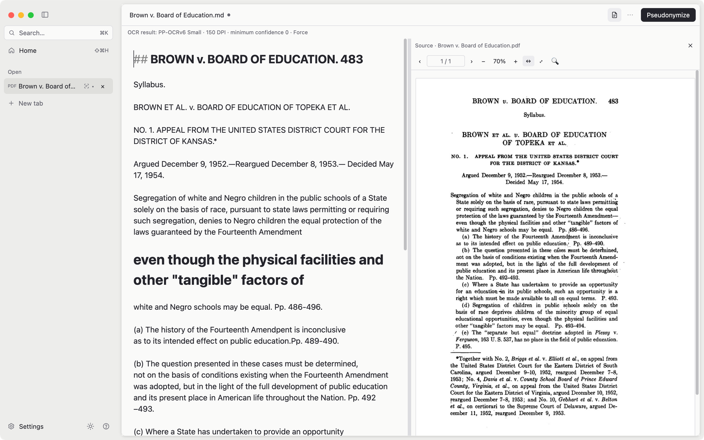
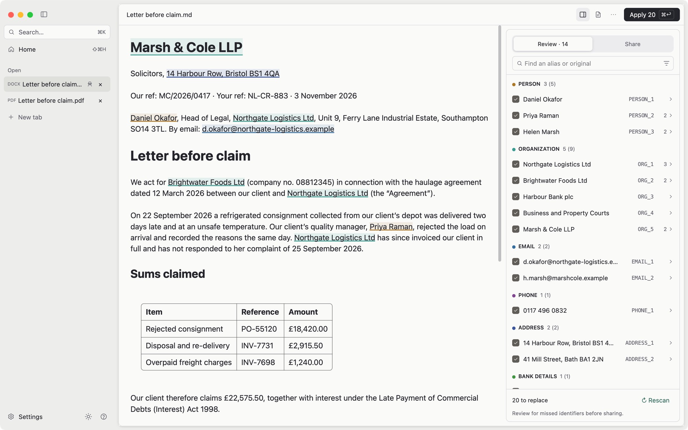
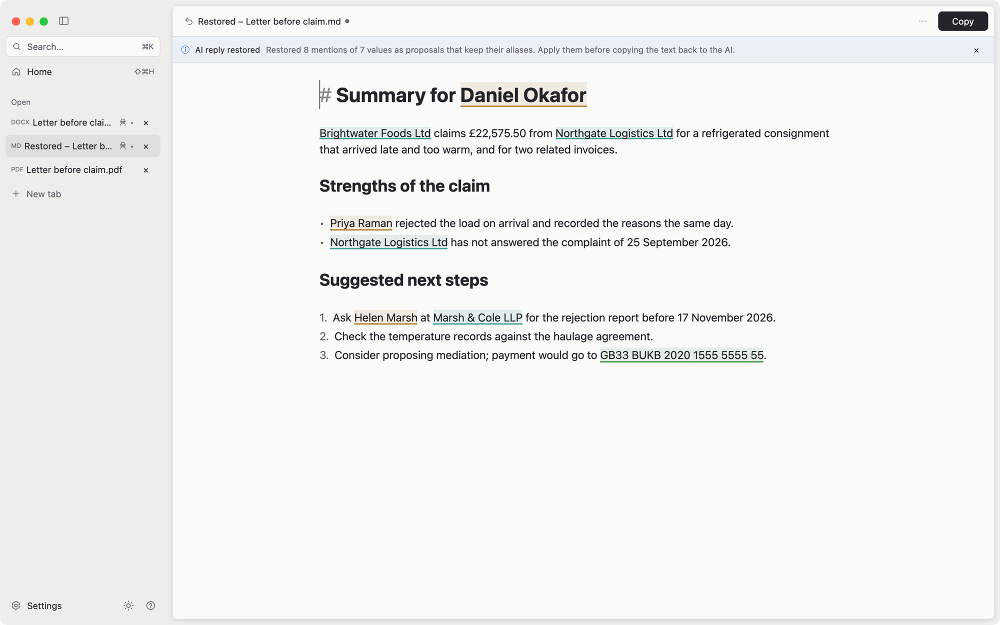

<h1 align="center">
  
   
  mdoc
</h1>

<b>Use AI on client documents without sending client names.</b>

  <picture>
    <source media="(prefers-color-scheme: dark)" srcset="docs/images/hero-dark.webp">
    
  </picture>

mdoc reads scanned PDFs, Word and other office documents, swaps names and other
identifying details for consistent aliases, and puts the real names back into
the AI's reply. Everything runs on your computer. Nothing is uploaded.
[Learn more](https://lawkitt.com/mdoc/).

**Reads scans.** Recognition runs locally, with the original page beside the text.

  <picture>
    <source media="(prefers-color-scheme: dark)" srcset="docs/images/ocr-dark.png">
    
  </picture>

**You review every replacement.** People, companies, emails, phone numbers,
addresses and bank details are proposed with consistent aliases; untick what
should stay and add anything detection missed.

  <picture>
    <source media="(prefers-color-scheme: dark)" srcset="docs/images/review-dark.png">
    
  </picture>

**The reply comes back with real names.** Copy for AI, paste the answer back,
and mdoc restores the originals in a new tab.

  <picture>
    <source media="(prefers-color-scheme: dark)" srcset="docs/images/restore-dark.png">
    
  </picture>
   
  Fictional letter and reply. Captured in mdoc 0.1.0-beta.11.

[Watch the films](https://lawkitt.com/mdoc/#demo-title) ·
[More screenshots and how they are made](docs/product-media/README.md)

## Installation

<h3>
  <picture>
    <source media="(prefers-color-scheme: dark)" srcset="docs/images/apple-dark.svg">
    
  </picture>
  macOS
</h3>

Download `mdoc_<version>_arm64.dmg` from [Releases](https://github.com/lawkitt/mdoc/releases).
Requires a Mac with Apple silicon and macOS 11 or later.

<h3>
  <picture>
    <source media="(prefers-color-scheme: dark)" srcset="docs/images/windows-dark.svg">
    
  </picture>
  Windows
</h3>

Download `mdoc_<version>_x64-setup.exe` from [Releases](https://github.com/lawkitt/mdoc/releases).
Requires Windows x64.

The installer is not signed yet. If Microsoft Defender SmartScreen appears,
select **More info**, then **Run anyway**.

> [!WARNING]
> Pseudonymization finds most identifying details, not all of them. Review the
> whole document before you share it. See [privacy and limitations](docs/privacy.md).

#### License

Licensed under the <a href="LICENSE">GNU General Public License, Version 3.0
or later</a>. Third-party licenses and attribution:
<a href="THIRD-PARTY-LICENSES.html">THIRD-PARTY-LICENSES.html</a>.

