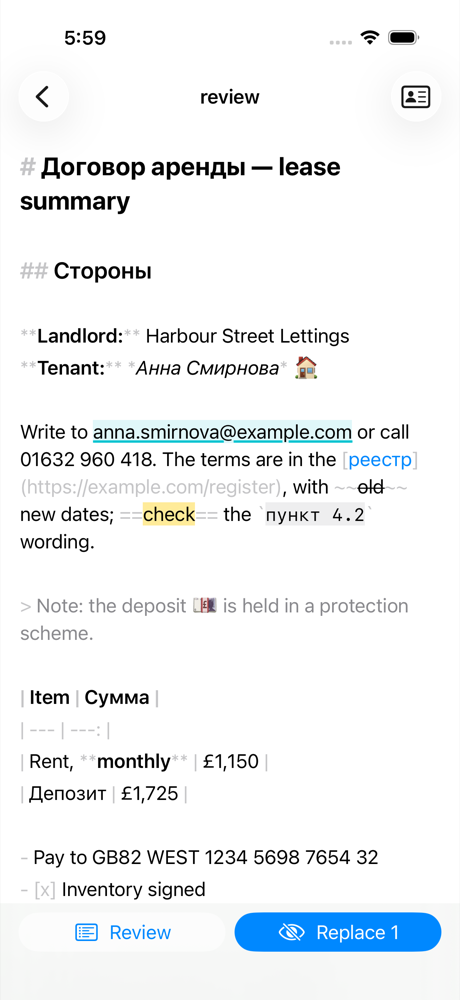
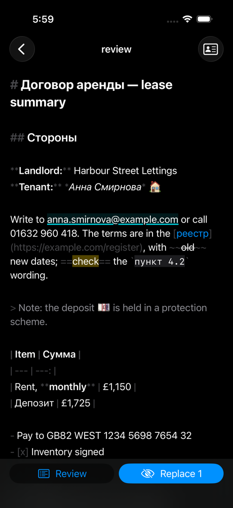
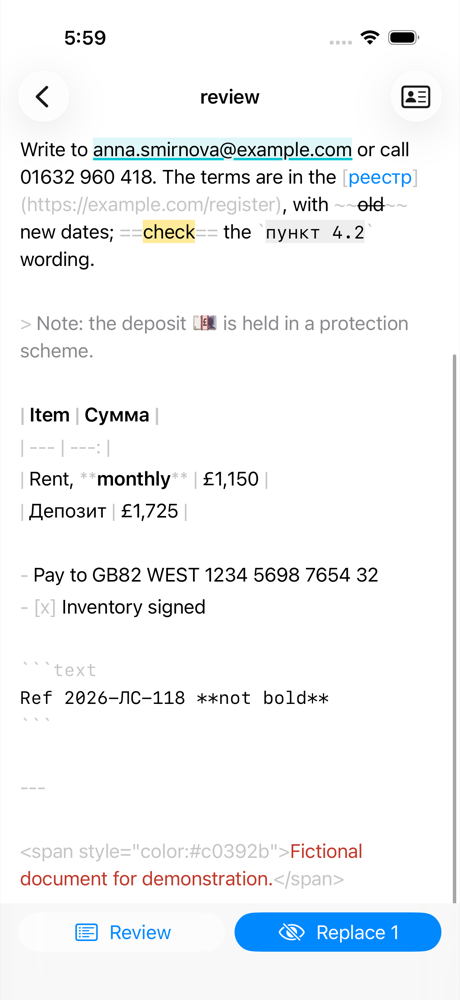
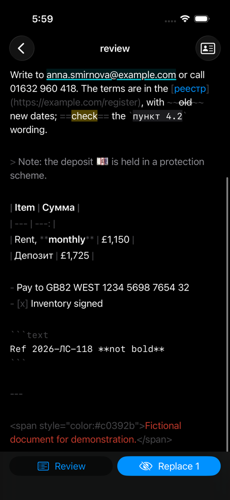

# iOS review on the core's Markdown spans, 2026-10-31

Light and dark screenshots of the review screen styled with the spans
`mdoc-ffi` gives from `mdoc-markdown` ([ADR 0085](../../../adr/0085-mobile-apps.md)'s
Text display rule): an iPhone 17 Simulator, iOS 26.1 (23B86), Xcode 26.1.1,
scaled to 1000 px high. The app imported
[`tests/fixtures/mobile-markdown/review.md`](../../../../tests/fixtures/mobile-markdown/review.md)
as pasted text and scanned it with the structured rules, which found the
email address; its underline lines up after Cyrillic text and emoji.

| Part | Light | Dark |
| --- | --- | --- |
| Headings, emphasis, the candidate, a link, strike, highlight, code, a quote, a table and a list |  |  |
| Scrolled to the end: a fenced block, a rule and the document's own colour |  |  |

Made by `mdocUITests/ScreenshotUITests` (`testMarkdownReviewLight`,
`testMarkdownReviewDark`; see [the shell's screenshots](../2026-10-31-shell/README.md)
for the command). The names and numbers are fictional.
