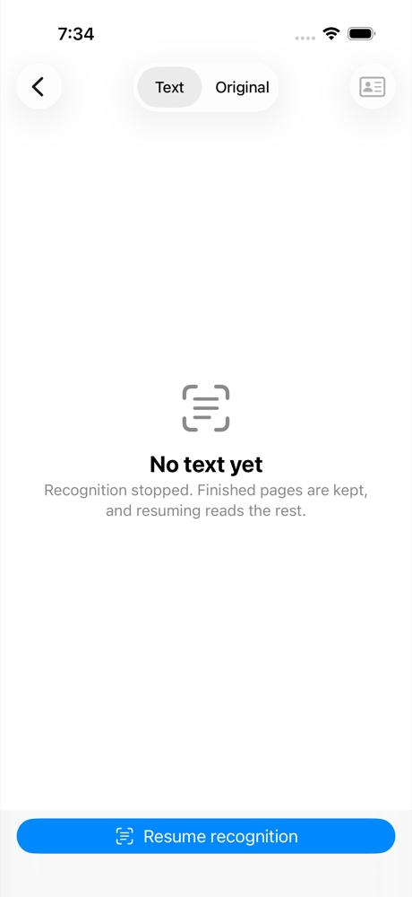
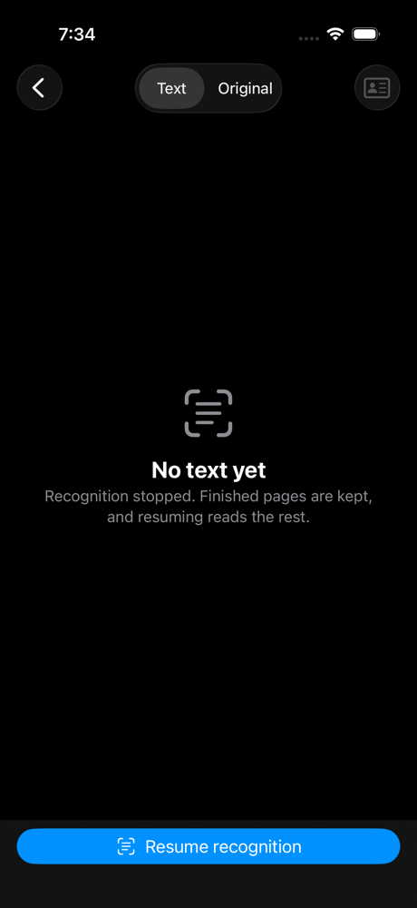
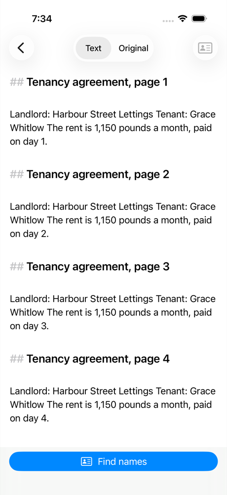
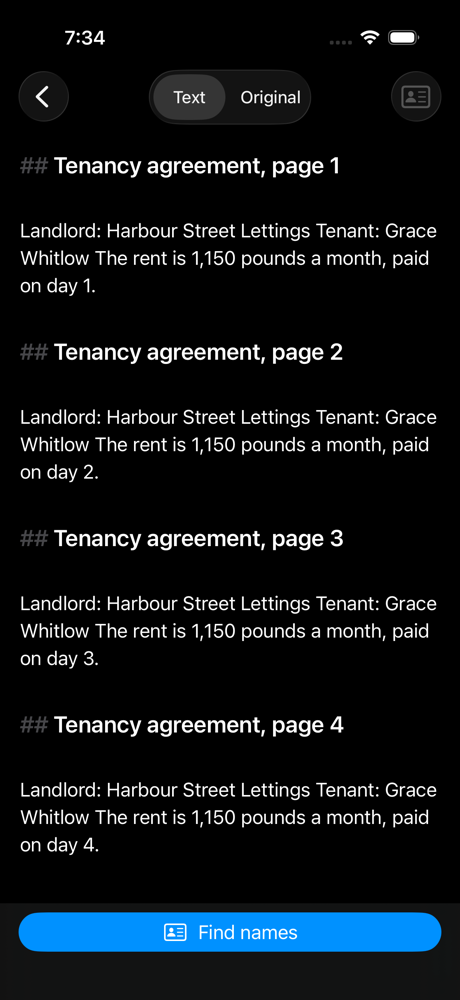

# iOS OCR that resumes, 2026-10-31

Light and dark screenshots of a camera scan's recognition cancelled
part-way and resumed, on the Rust core
([ADR 0085](../../../adr/0085-mobile-apps.md) Long jobs): an iPhone 17
Simulator, iOS 26.1 (23B86), Xcode 26.1.1, scaled to 1000 px high. Four
rendered pages of a fictional tenancy came in as a scan (one image-only
PDF), the English and Russian OCR model downloaded (18 MB) and the core
installed it. Recognition was cancelled after six seconds, and Resume
recognition read the pages left.

| State | Light | Dark |
| --- | --- | --- |
| Cancelled: finished pages are kept, and the primary action resumes |  |  |
| Resumed: all four pages recognized |  |  |

Made by `mdocUITests/ScreenshotUITests/testOCRResume`, which downloads the
model, so it runs only with `MDOC_OCR_TESTS=1` as well as
`MDOC_SCREENSHOTS=1`:

```sh
TEST_RUNNER_MDOC_SCREENSHOTS=1 TEST_RUNNER_MDOC_OCR_TESTS=1 xcodebuild -project apps/ios/mdoc.xcodeproj -scheme mdoc \
  -destination 'platform=iOS Simulator,OS=26.1,name=iPhone 17' \
  -derivedDataPath target/ios/DerivedData -only-testing:mdocUITests/ScreenshotUITests/testOCRResume test
```

`mdocTests/OCRResumeTests` (also `MDOC_OCR_TESTS=1`) checks the pages
themselves: it cancels once the core has kept a page, starts the core again
and resumes to exactly the uninterrupted text, and a dropped import leaves
no pages.
