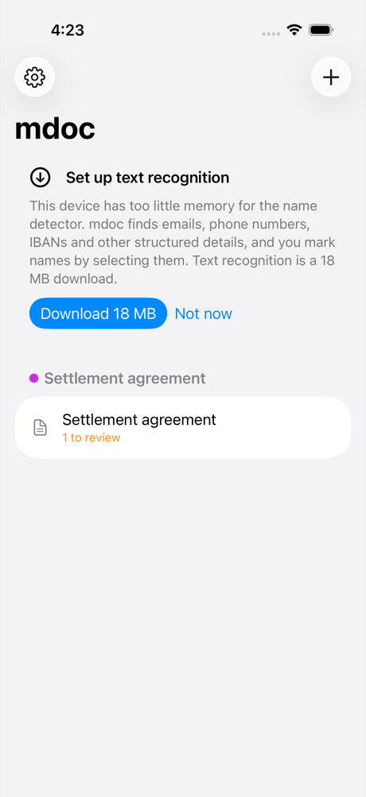
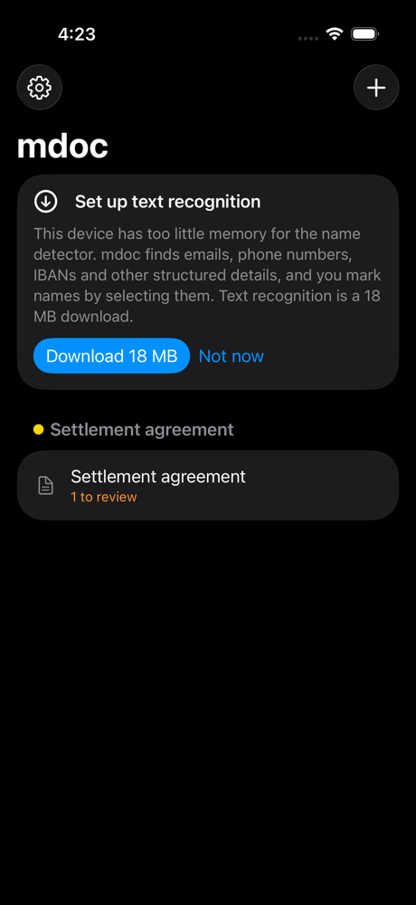
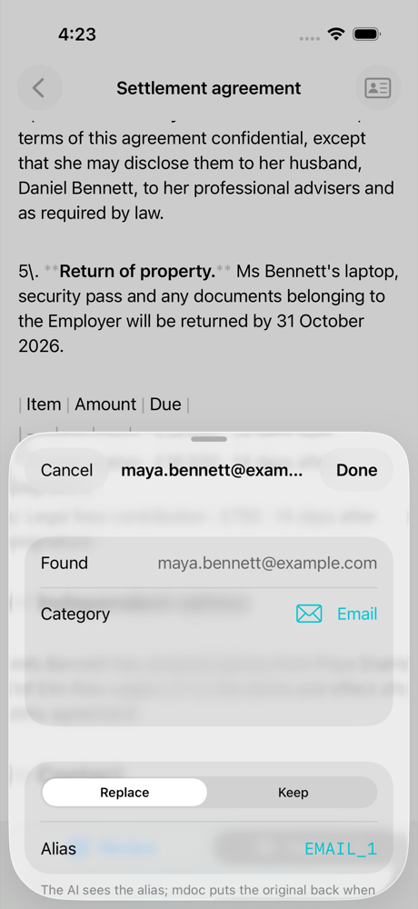
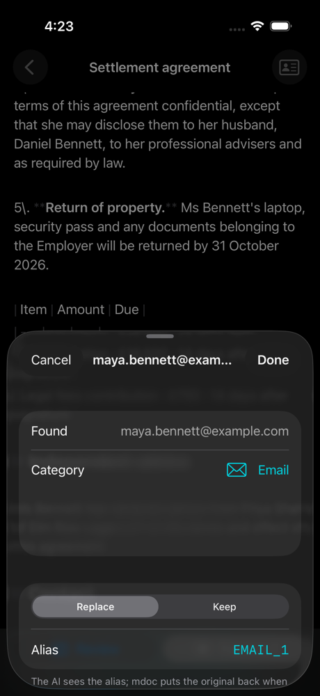
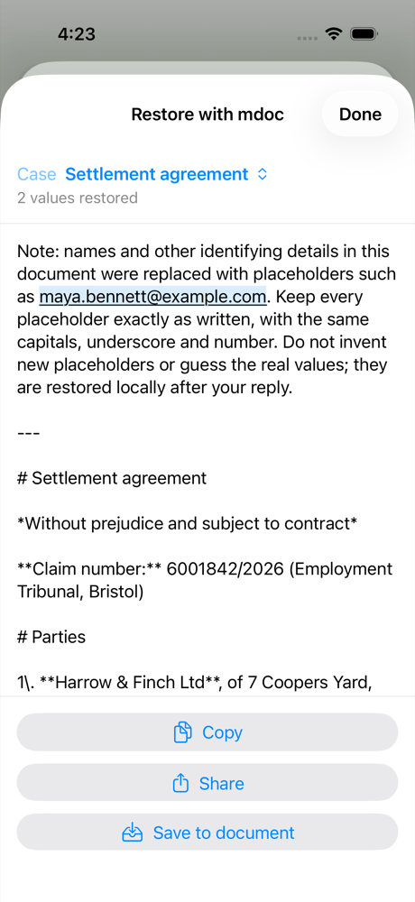
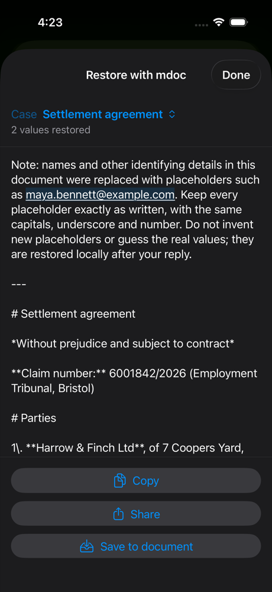

# iOS app on the Rust core, 2026-10-31

Light and dark screenshots of the iOS app and its Restore with mdoc
extension running on `crates/mdoc-ffi` ([ADR 0085](../../../adr/0085-mobile-apps.md)):
an iPhone 17 Simulator, iOS 26.1 (23B86), Xcode 26.1.1, scaled to 1000 px
high. The app imported `docs/product-media/Settlement agreement.docx`
through the core and scanned it with the structured rules (UI-test mode:
below the detector's memory floor, so no model is needed), which found the
email address.

| Screen | Light | Dark |
| --- | --- | --- |
| Home: the imported document in the case it started, and the setup card |  |  |
| Review: the rules' candidate and its sheet, with the core's alias |  |  |
| Restore with mdoc: the shared Copy for AI text restored with the current case |  |  |

Made by `mdocUITests/ScreenshotUITests` (see
[the shell's screenshots](../2026-10-31-shell/README.md) for the command).
The names and numbers are the demo's fictional ones.
