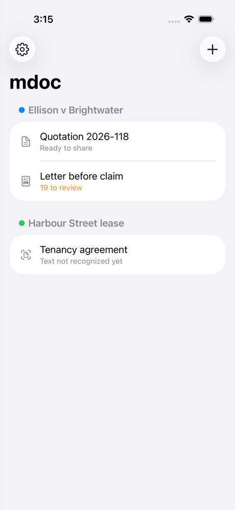
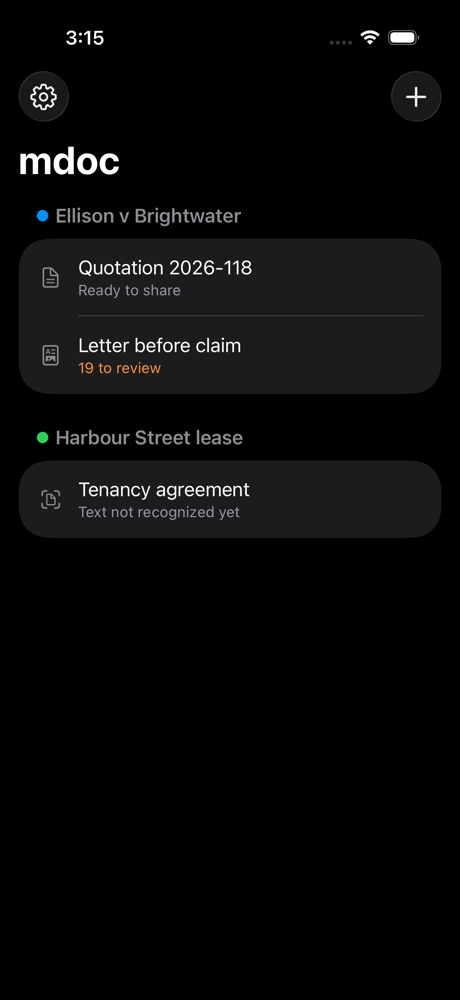
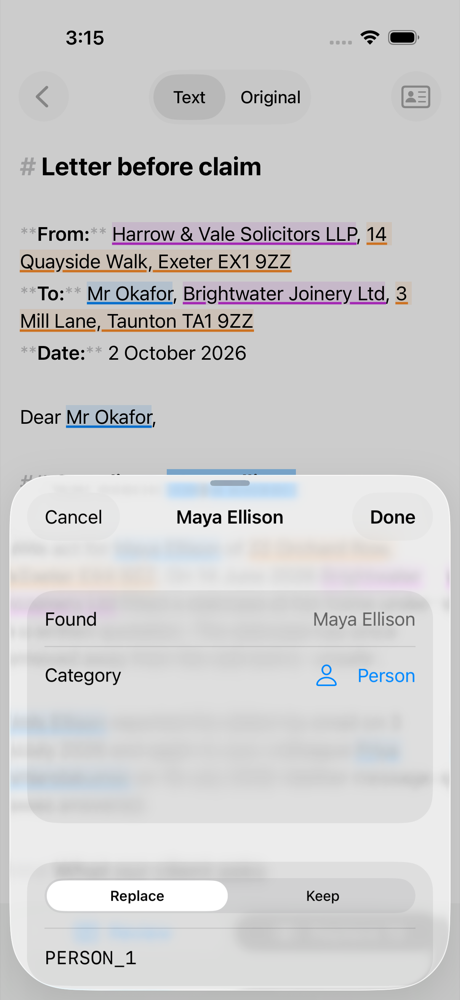
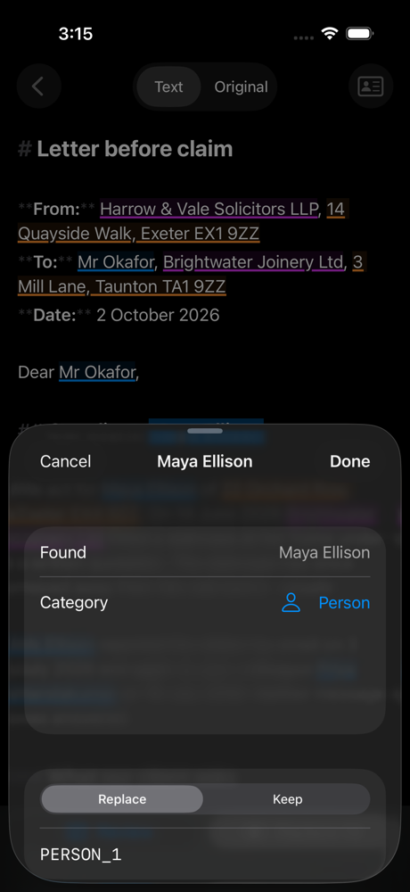
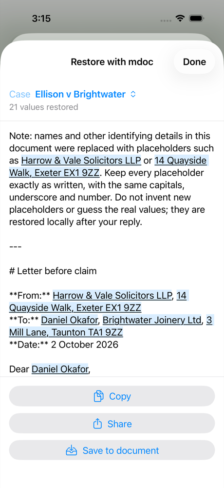
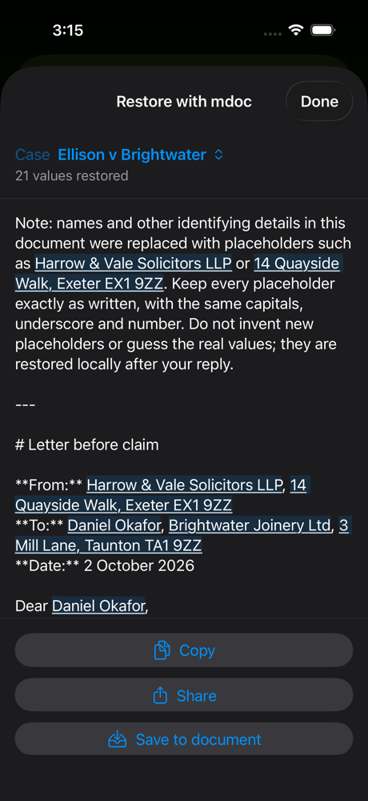

# iOS app shell, 2026-10-31

Light and dark screenshots of the first iOS app piece
([ADR 0085](../../../adr/0085-mobile-apps.md)) on the fake core: an iPhone 17
Simulator, iOS 26.1 (23B86), Xcode 26.1.1, scaled to 1000 px high.

| Screen | Light | Dark |
| --- | --- | --- |
| Home: documents by case |  |  |
| Document with the candidate sheet |  |  |
| Restore with mdoc, shared from the app's share sheet |  |  |

Made by `mdocUITests/ScreenshotUITests` (skipped unless the run sets
`MDOC_SCREENSHOTS=1`):

```sh
TEST_RUNNER_MDOC_SCREENSHOTS=1 xcodebuild -project apps/ios/mdoc.xcodeproj -scheme mdoc \
  -destination 'platform=iOS Simulator,OS=26.1,name=iPhone 17' \
  -derivedDataPath target/ios/DerivedData -only-testing:mdocUITests/ScreenshotUITests test
```

The attachments come out of the result bundle with
`xcrun xcresulttool export attachments`. All names and numbers are the fake
core's fictional fixtures.
