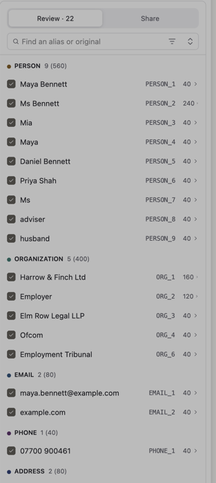
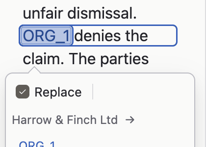
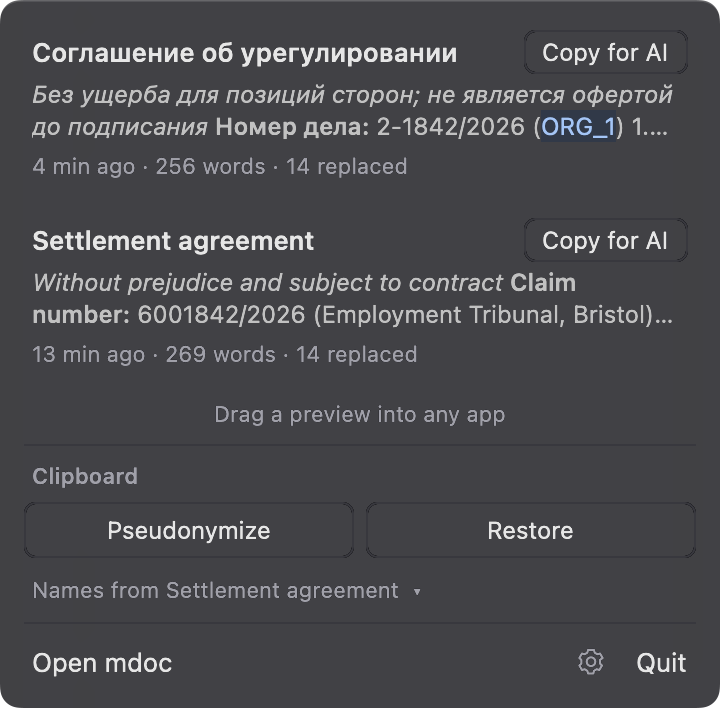
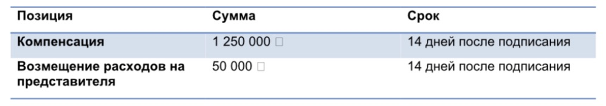
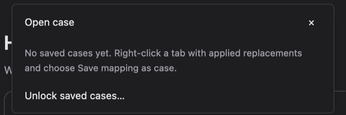
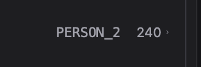
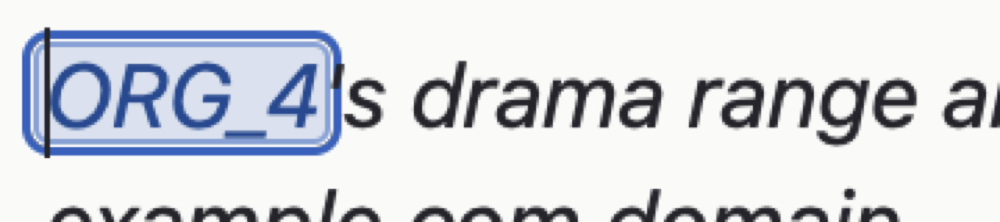
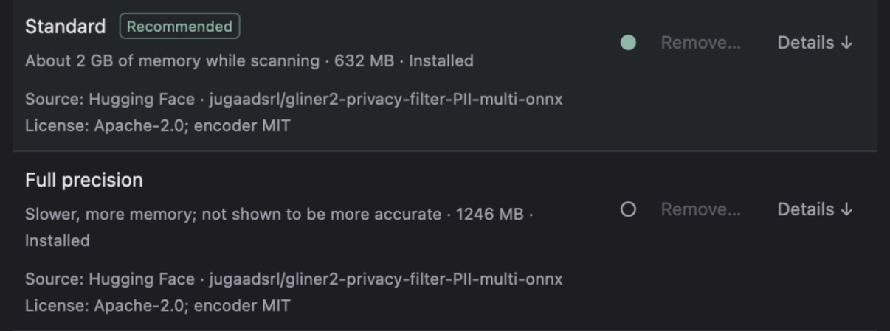
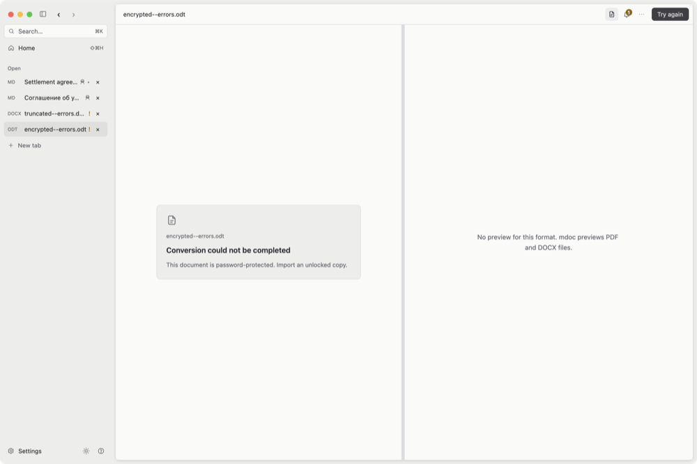
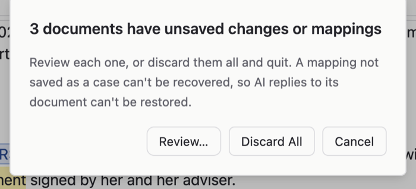

# UI/UX survey, 2026-10-31

A hands-on bug hunt of the macOS desktop app by computer use, run while the
maintainer was away. Findings are filed at the end of `## Later` in
[ROADMAP.md](../../../../ROADMAP.md), most severe first; this page holds the
repro steps and screenshots. IDs (U1–U31) match the order there.

## Setup

- **Build:** debug `target/debug/mdoc` from `main` at `84fafd3` ("Shelf: on
  by default, and polish (ADR 0084) (#280)"), copied into
  `~/Applications/mdoc-dev.app` (bundle id `io.github.lawkitt.mdoc.dev`).
  Timings below come from a debug build and are not representative.
- **Mac:** Apple Silicon, macOS 15 (Darwin 24.6), Retina, system appearance
  Dark, a Russian keyboard layout installed. Models already installed:
  detection Standard and Full precision, OCR English and English & Russian.
- **Profile:** the real profile was copied aside first; `session.json` and
  `recents.json` were removed for a first-launch Home and restored afterwards
  (the profile now matches the backup byte for byte). No case was saved; the
  Keychain explainer was dismissed with Not now.
- **Inputs:** copies in a scratch folder of `docs/product-media/` (both demos,
  `.md` and `.docx`), `tests/fixtures/import/` (`text.pdf`,
  `handmade-scanned.pdf`, `truncated--errors.docx`, `encrypted--errors.odt`),
  the English demo under a 98-character file name, and `long-document.md`
  (the English demo 40 times under `## Section N` headings, 80 KB).
- **Covered:** Home (empty and with recents), opening by Finder and by the
  palette, Markdown/DOCX/PDF/OCR import and their error states, the editor,
  Pseudonymize, the popup and its category menu, the Replacements list, Share
  (Copy for AI, AI reply restore), Side by side, Find and Replace, History,
  Settings (every category, keyboard), the palette, Keyboard Shortcuts, the
  sidebar and its context menu, notices, Open case, the Keychain explainer,
  the Save and Quit prompts, the menu bar shelf and its source chooser, all
  app menus, zoom, F6 regions and Tab order; Light and Dark; the minimum
  window (720×480), 1500×1000 and full screen width.
- **Not covered:** drag and drop (Finder, shelf drag-out), IME, VoiceOver,
  the model download screens (models were installed), an unlocked case
  (unlocking would raise a Keychain password prompt), the first-close shelf
  note, and hover cursor shapes (screenshots don't show the pointer).

## Bugs

### U1. Paste text opens an empty tab

1. Copy any plain text (tried a two-line English and Russian sample).
2. Home › **Paste text**, or ⌘K › "Paste text as new tab".
3. An `Untitled.md` tab opens with the "Type here…" placeholder; the text
   never arrives. ⌘V in that tab pastes it fine. Reproduced twice; each try
   leaves another empty Untitled tab.

`paste_as_new_tab` (`src/workspace/shell.rs`) calls `new_tab` and then
dispatches `mdoc_editor::Paste` in the same turn, most likely before the new
editor holds focus, so the action finds no handler. Defer the paste until the
editor is focused, or insert the clipboard text into the new buffer directly.

### U2. Both demos send addresses, dates of birth and a first name to the AI

English demo: Pseudonymize, Apply 24, Copy for AI. The clipboard still reads
"Ms PERSON_1, of Flat 3, 41 Larch Road, Bristol BS6 9ZY, born 14 March 1988"
(Maya's home address and date of birth). Russian demo (`.docx`): Apply 18,
Copy for AI keeps both street addresses ("191187, Санкт-Петербург, Литейный
проспект, д. 7, офис 12", "197101, Санкт-Петербург, Ольховый переулок, д. 41,
кв. 3"), "дата рождения 14 марта 1988 г." and "Марина обратилась в суд".
Share still says "18 replaced. Names in the text are aliases now."

Date is in the popup's category menu but not in Settings › Detection ›
Categories to detect, so a date of birth can never be proposed. "Марина" is a
word of the known original "Марина Сергеевна" but not itself an original, so
the readiness check passes it.

### U3. The same text scans differently inside a longer document

`long-document.md` (the English demo repeated 40 times under `## Section N`)
scans to 22 identities: "Ms", "adviser" and "husband" become PERSON_7–9 (40
mentions each), "Employment Tribunal" ORG_6, "example.com" EMAIL_2, the claim
number is now proposed, and only "Flat 3, 41" of Maya's address is. The single
demo gets none of these. Applying would turn "her husband" into "her
PERSON_9". Organisation aliases skip ORG_5.

(Captured under the Keyboard Shortcuts scrim, hence grey.)

### U4. The selection ring of an applied alias keeps the original's width

Minimum window (720×480) with the sidebar and Replacements open; English demo
after Apply; click ORG_1 in Background ("ORG_1 denies the claim"). The ring
runs from ORG_1 to "denies the", about the width of "Harrow & Finch Ltd".
Not checked at other widths.

### U5. The shelf's "N replaced" counts something else than the editor's

The shelf lists the English demo as "14 replaced" and the Russian one as "14
replaced"; their Share tabs say "24 replaced" and "18 replaced". The shelf
counts identities (its hover reads "8 people · 3 organisations · 1 email · 1
phone number · 1 ID"), the editor counts mentions.

### U6. The DOCX source preview draws ₽ as an empty box

Open `Соглашение об урегулировании.docx`; in Source, the table reads "1 250
000 □" and "50 000 □", and the text "1 250 000 в течение" loses the sign.
The editor shows ₽. Light and Dark.

### U7. Recent marks files "pseudonymized" that aren't, and lists conversions twice

After scanning `long-document.md` without applying anything, Home › Recent
shows it "pseudonymized". The Russian demo appears twice, as `.docx` and as
the `.md` saved from it, both "pseudonymized"; the `.docx` itself never was.

### U8. Locked-case messages contradict what Home shows

- First launch with an empty session, open the English demo: the toolbar bell
  shows "1 notice": "Saved cases are locked. Unlock them to restore
  replacements in their documents." The document belongs to no case and Home
  lists no cases.
- Home › Open a case…: "No saved cases yet. Right-click a tab with applied
  replacements and choose Save mapping as case." directly above "Unlock saved
  cases…" (the dev profile holds four locked cases). The popover opens at the
  content's top left, over "Hello", not at the link.

### U9. Three-digit counts squeeze the row chevron

Replacements rows "Ms Bennett 240" and "Harrow & Finch Ltd 160" (long
document) draw the chevron as a dot.

### U10. A running scan says "Nothing to replace yet"

During every scan the panel footer reads "Nothing to replace yet" under the
skeleton rows (Rescan is enabled on the short demo). The only progress is the
toolbar's "Analyzing…" then "Finding names…"; the long document took about 75
seconds in the debug build with no percentage or page count.

### U11. A tab's tooltip covers its context menu

Hover a sidebar tab until its path tooltip shows, then right-click: the
tooltip stays on top of the new context menu and hides it until the pointer
moves.

### U12. A tab opened in the background shows a `.md` name it doesn't have

Open `truncated--errors.docx` and `encrypted--errors.odt` together. Before
activation the second tab reads `encrypted--errors.md` in the sidebar and its
tooltip names `…/encrypted--errors.md`, which doesn't exist; once activated it
reads `encrypted--errors.odt`.

## Polish

### U13. Alias chips touch or cover the next character

"PERSON_2's" (upright): the apostrophe sits on the chip border. "ORG_4's" in
the italic footnote with the caret on it: the ring covers half the
apostrophe. Earlier, before Apply, the ring around "Mia" touched the comma. The
popup's alias field shows its pencil glyph flush against the alias on hover.

### U14. One action, several names

- Restore AI reply (Home, palette) / Paste AI Response (File menu) / Paste AI
  reply… (More actions).
- Save as case (Share) / Save mapping as case (sidebar menu, Open case hint).
- Before / After (View menu, palette) / Side by side (view bar).
- Spelling mixes UK and US: "unrecognised", "App licence", "organisations"
  (shelf) beside "Organization", "License: Apache-2.0", "Recognize".

### U15. Menus

No File › Open Recent; no Restore Clipboard item (Edit has Pseudonymize
Clipboard); View lacks Home (⇧⌘H), Search (⌘K), Original / Pseudonymized /
Side by side, and the Replacements panel; Help has only Keyboard Shortcuts (no
mdoc Help, which the sidebar's ? opens); no Check for Updates… in the app
menu; Copy for AI and Copy Markdown have no shortcut anywhere.

### U16. Tooltips

Sidebar tooltips (Collapse sidebar, Back, Forward, New tab) show no shortcut
though ⌃⌘S, ⌘[ and ⌘] exist; the toolbar's Pseudonymize button has no tooltip
at all (⇧⌘P); the popup's alias field has none ("Rename alias") while its
Replace checkbox does. "Documents stay on this Mac" opens its tooltip down and
left over "Pseudonymize clipboard". The palette's "Switch theme (Light)" reads
as the current theme or the next; the same panel icon stands for Open a case…,
Before / After and Toggle sidebar.

### U17. Settings

- Detection and Recognition: the enabled "Remove…" of an inactive model has
  the same dim grey as the disabled one of the active model; only hover tells
  them apart.
- Toggles don't share a column ("Check now" pushes Automatic updates' toggle
  left); off toggles keep an accent-tinted knob and border.
- About ends with a disabled "Reset — There are no preferences in this
  category."
- Long pages cut a row in half ("Compare pseudonymization") with no scroll
  cue.
- Appearance: the selected segment (border, bold) and the focused one (ring)
  look alike, so with focus on Light and System selected both read as chosen.

### U18. Import error and OCR cards

- Damaged DOCX and password-protected ODT: the toolbar's primary action is
  "Try again", which can't help; the card offers nothing else (Close tab, Open
  another…); the Source pane still takes about 60% of the width to say "can't
  be previewed" or "No preview for this format".
- `handmade-scanned.pdf` (blank pages): the card offers "Use native text only"
  though "No page has usable text"; "Run OCR" is drawn less prominently than
  that secondary button; the text mixes "OCR" and "text recognition". The
  result is two stray "I" characters at minimum confidence 0, with no "no
  text recognized" message.
- The sidebar's "!" means both "needs OCR" and "conversion failed".

### U19. Save as case asks for a file first, then for the Keychain

On a converted, unsaved document, Share › Save as case shows the Save panel
(which offered to replace the demo's existing `.md`), then the Keychain
explainer. Not now leaves the file saved, no case, and no message.

### U20. Native panels ignore the app theme

With Settings › Appearance on Light and macOS in Dark, the Save panel, its
Replace alert and the menus stay dark.

### U21. Narrow windows

At the minimum size (720×480) with the sidebar and Replacements open the
editor column is about 270 pt, three or four words a line. The sidebar is a
fixed 180 pt and can't be dragged wider, so names truncate early
("Settlement agree…" once the mask icon and dirty dot show) and two names
with a shared prefix look the same.

### U22. Dialogs

Save changes: Save is only ringed, not filled; the order Save · Discard ·
Cancel differs from macOS's (Don't Save … Cancel, Save); in Dark the dialog
barely separates from the editor (no scrim). The Quit summary says "3
documents have unsaved changes or mappings" with seven tabs open and doesn't
say which.

### U23. Shelf details

The preview of a converted document ends "(ORG_1) 1...." (an escaped list
number plus the ellipsis); the gear's "Settings" tooltip is clipped by the
shelf's right edge; the "Names from … ▾" chooser replaces the document list
at the top of the shelf, far from its trigger at the bottom, and the shelf
shrinks.

### U24. The floating view bar

The view bar (Edit, Original, Pseudonymized, Side by side, Reply, zoom)
appears only near the bottom edge or while scrolling; the zoom-only pill that
appears on scroll covers the line under it; a hovered segment has the same
fill as the selected one.

### U25. Small alignment and style items

Home's "Open a case…" ends about 7 pt left of "Documents stay on this Mac"
above it; the AI reply's "Next unrecognised" is borderless beside bordered
"Copy reply" and "Open as tab"; the Reply view's "Reply" chip and "Close"
button don't share a baseline; on Home the first Tab goes to the toolbar's
bell before "Open files…".

### U26. Pseudonymize clipboard from Home

Home › Pseudonymize clipboard switches to the last document tab and replaces
only that document's known names; new text ("John Smith of Acme Ltd") comes
back "unchanged". From Home that reads as broken.

## Ideas

- **U27.** Russian demo: one person gets six aliases (Павлова Марина
  Сергеевна, Марина Сергеевна, Маришей, Павловой М. С., Павлова, Павловой)
  and one merge hint (Павлова). A name with patronymic is a strong signal.
- **U28.** The Replacements panel sits between the editor and its Source
  preview; hide the Source pane when it has nothing to show.
- **U29.** The demo `.docx` uses literal "1." numbers and Heading 1 for
  sections (`make-demo-docx.py`), so its import shows "1\." paragraphs and
  only H1s; `text.pdf` imports `<s>` and `` as literal tags.
- **U30.** View › Zoom scales the editor only.
- **U31.** The sidebar tab menu has only Save mapping as case and Close tab.

## Checked and fine

Home empty and populated states; Light/Dark on every surface listed above;
the replacement popup (stacked layout in narrow windows, category menu, Esc
returning focus); Apply, Copy for AI (note plus Markdown, Cyrillic intact),
restore with an unrecognised alias highlighted; Side by side; Find and
Replace; palette search and its empty state; Settings keyboard focus;
F6 regions returning to the last control; Home scrolling and reflow at the
minimum size; the Save/Discard prompt; the Quit summary's Discard All; the
shelf in both themes and its breakdown tooltip; zoom in and reset.
