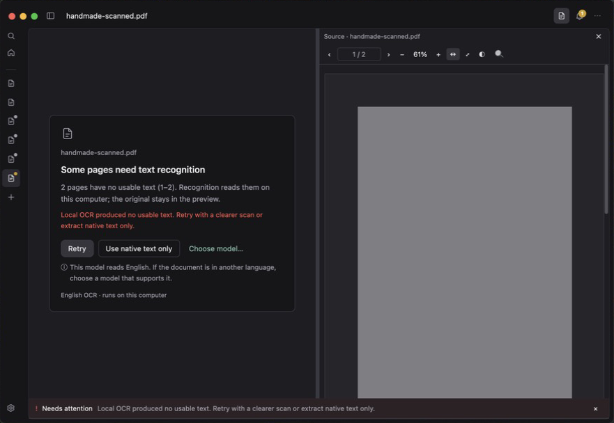
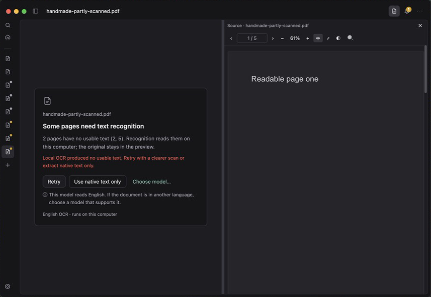
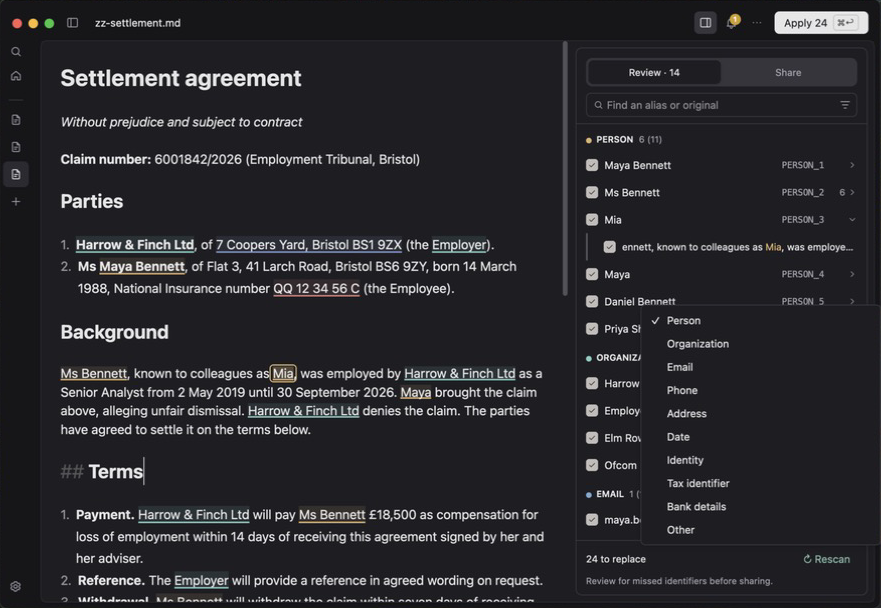
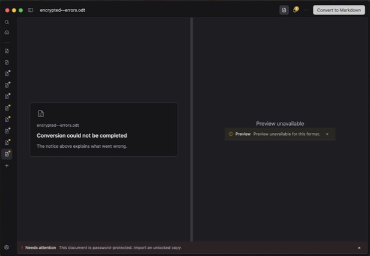
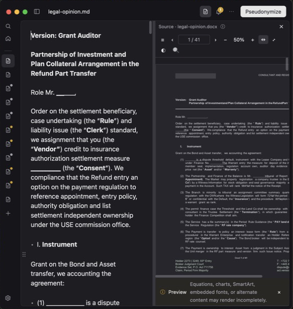
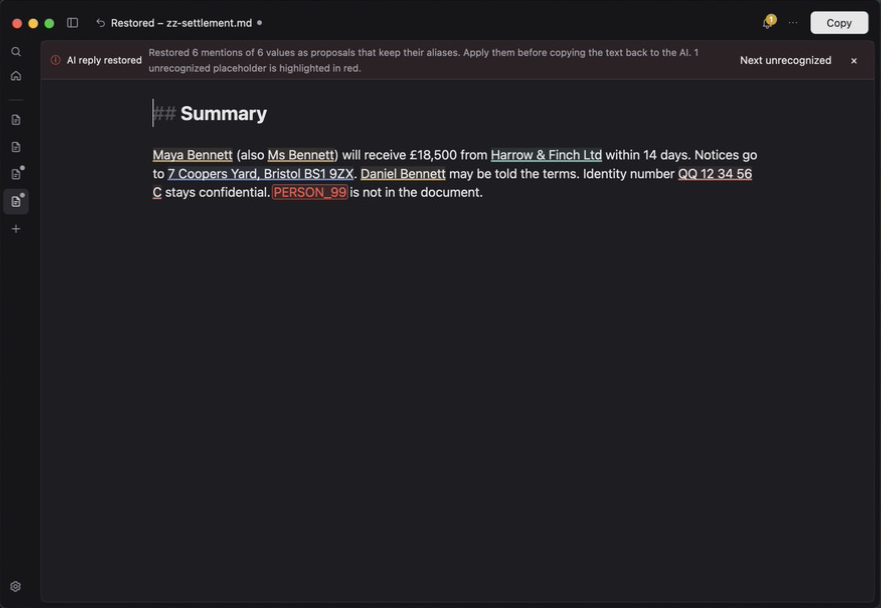
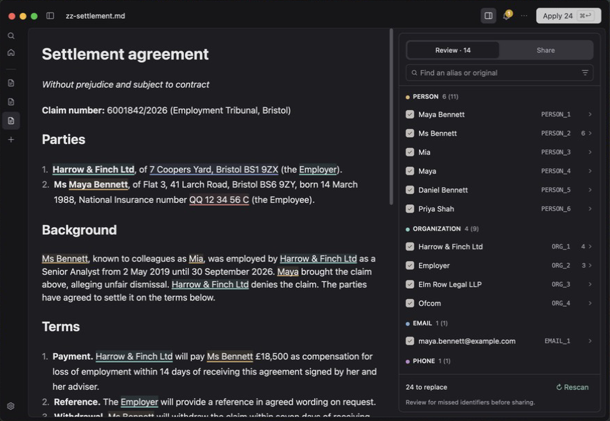
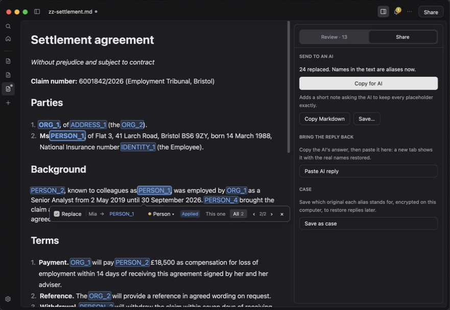
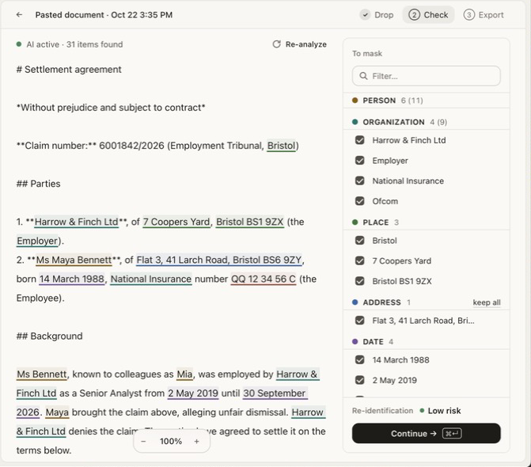
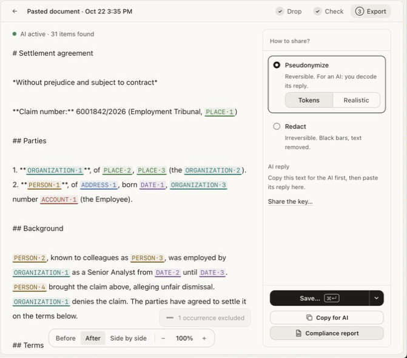

# UX review: mdoc 0.1.1 and Anoni 0.86.0 (2026-10-22)

Hands-on computer-use exploration of the installed apps on macOS, looking for
mdoc bugs, UX improvements and feature ideas. The previous Anoni comparison
(0.81.1) is [ADR 0046](../../../adr/0046-workspace-polish-from-anoni-review.md).

## Ground rules (agreed before the run)

- **Routing follows [ADR 0059](../../../adr/0059-roadmap-after-0-1-0.md).** Bugs
  become GitHub issues, filed directly with `gh`; patch-rule bugs get the patch
  milestone. Ideas go to the end of ROADMAP.md *Later* as one-liners, without
  reordering. Only findings serious enough for 0.2.0 get full items there.
  This README holds the detail and screenshots.
- **Issues:** each stands alone (fixture repro, expected vs actual); a link to
  this folder is added once it is on `main`. Patch-rule bugs: `bug` + 0.1.2;
  other bugs: `bug`, no milestone; ideas: no issue. Duplicates of open issues or
  roadmap points get a comment with new facts, not a new issue.
- **Data:** repo fixtures (synthetic) plus a few real legal files from
  `~/Downloads` (two legal opinion DOCX files, a Russian court PDF, a law DOCX);
  no personal files (lab results, bills, books). In Anoni, only documents
  brought in for this review are opened; its existing history is not opened or
  captured.
- **Screenshots:** only fixture screenshots are committed. Real-file screenshots
  stay outside the repo; such findings are described in words and reproduced
  with a fixture where possible.
- **Side effects:** no model downloads over ~200 MB; saves go to a scratch
  folder; cases are created only as `zz-ux-review-*` and removed afterwards;
  existing cases and settings are left as found.
- **Scope:** a whole-app tour of both apps, with extra attention on what Anoni
  added since 0.81.1; about 1–2 hours.
- **Not planned conflicts:** Anoni features that conflict with mdoc's Not
  planned list are recorded below and are not added to the roadmap.
- **Delivery:** one local commit on branch `ux-review-2026-10-22`; no new ADRs.
  Findings that need a decision say "ADR first".

## Run

2026-10-22, about 25 minutes of hands-on exploration on macOS 15 (Apple
Silicon) with installed mdoc 0.1.1 and Anoni 0.86.0, by Claude Code with
computer use. Fixtures were copied to a scratch folder first; the four real
files were opened in mdoc only (the 37-page opinion for find and preview, the
Russian court PDF for OCR). Both apps' recents, session, settings and
preference files were backed up before and restored after; no case was
created and no model was downloaded.

**Not covered:** saving a case and restoring from one (Save as case needs the
Mac login password in a Keychain prompt, which the agent may not type),
English & Russian OCR, keyboard-only use beyond what is already in 0.2.0
must-fix, VoiceOver, Windows, Anoni cases, journal and database (they hold the
user's history). Anoni did not open files from the scratch folder (likely its
sandbox), so its DOCX preview and error handling were not compared.

## Findings

### mdoc bugs

| Finding | Became |
| --- | --- |
| A failed OCR run ("no usable text") on one PDF is shown with Retry on every other PDF tab, including ones opened later that never ran OCR. The per-document error is stored as the shared OCR install state.   | [#90](https://github.com/lawkitt/mdoc/issues/90), 0.1.2 |
| The DOCX preview joins words in justified lines that start after a tab: "Investmentand", "RefundPart" in `legal-opinion.docx`; the real 37-page opinion shows the same ("MitigationInstruments"). The Markdown is correct. | [#91](https://github.com/lawkitt/mdoc/issues/91), 0.1.2 |
| Escape doesn't close the Replacements panel's right-click menu; it closes the mention popup behind it.  | [#92](https://github.com/lawkitt/mdoc/issues/92) |
| The failed-conversion card says "The notice above explains what went wrong"; the notice is at the bottom.  | [#93](https://github.com/lawkitt/mdoc/issues/93), 0.1.2 |
| The popup also stays open after the toolbar's Apply N button, a click outside it, not only after ⌘↩. | Comment on [#78](https://github.com/lawkitt/mdoc/issues/78#issuecomment-6336582863) (0.2.0 must-fix 1) |

### mdoc UX

| Finding | Became |
| --- | --- |
| In a ~575 pt window the preview toolbar wraps to a second row, and Fit width stops at 50%, so the page is clipped behind a horizontal scrollbar.  | Later: narrow windows |
| Error and empty states: a corrupt DOCX preview says "DOCX preview package is invalid: invalid ZIP" with a Retry that cannot help; an unsupported format shows "Preview unavailable" twice (heading and notice); the OCR card says "Some pages need text recognition" when all pages do. | Later: plain error states |
| The Notices badge and popover "Saved cases are locked. Unlock them to restore replacements in their documents." open on their own when a plain fixture DOCX is opened, covering the preview. | Later: locked-cases notice |
| The restore banner ("Restored 6 mentions of 6 values as proposals that keep their aliases. Apply them before copying the text back to the AI.") is hard to parse; unknown placeholders in red and Next unrecognized work well.  | Later: restore banner wording |
| Closing a pseudonymized, unsaved tab asks twice in a row (keep the mapping, then save changes); Quit asks once per unsaved tab with no Discard all. Quit not asking about mappings is by design (ADR 0041). | Later: one close prompt; ADR first |
| Home and Open say "PDF, DOCX or Markdown", but mdoc also converts DOC, ODT and XLS/XLSX. | Later: format hints |
| The Replacements panel's mention snippets start mid-word ("ennett, known to colleagues as Mia"); the ⋯ menu's Copy for AI is disabled before pseudonymizing with no reason. | Later: snippets and disabled reason |
| Detection on the settlement demo missed the second address, the date of birth and the claim number, and proposed "Employer" as an organization; Anoni found the address and all four dates. Model quality, for the ongoing qualification track.  | No change (Ongoing tracks) |
| Worked well: Same as… links "Mia" to Maya Bennett in two clicks; one undo reverts Apply all and Share switches back to "24 still to replace"; find on the 37-page opinion (64 matches) is fast; the Share tab explains each step.  | — |
| View › Zoom In/Out/Actual Size are disabled while editing; ADR 0046 keeps views without zoom, so no item. | — |

Already on the roadmap, seen again: Toggle Sidebar has no shortcut, the DOCX
notice shows for every DOCX, same-name tabs (`sheet.xls`, `sheet.xlsx` both
read "sheet.md") (0.2.0 should-fix *Small polish*); Russian OCR defaults to
English (*Pick the recognition language*); several mentions of one person get
separate aliases until linked (Later: merge hint); Settings layout (Later:
Settings redesign).

### Anoni ideas worth taking

Anoni 0.86.0 compared with the 0.81.1 review (ADR 0046):

| Anoni | mdoc | Became |
| --- | --- | --- |
| **Connect an AI**: ships a connector so Claude or ChatGPT read documents through it "and never see the real data". | Copy for AI and paste back only. | Deferred: agent access (moved there at the 2026-10-23 grooming), so not added to Later |
| **Convert › Image → text**: OCR for screenshots and photos of pages. | PDF scans only. | Later: images through OCR |
| Global clipboard shortcut (⌘⇧A), Settings with a category list (General, Detection, License, Data, About). | Already in Later. | — |
| Clicking a mention excludes it at once with a "1 occurrence excluded · Undo" toast. | Popup with Keep. | README only: faster, but it would change the popup model of ADR 0055 |
| Models page sized to the machine ("Your machine has 24.6 GB of RAM", memory per model, language combinations). | Model choices with size and memory. | README only |
| Character and word count while pasting. | None. | README only |

 

Anoni does worse: Finder's Open With does nothing; its file dialog greys out
DOC, ODT and XLS; the Markdown is shown as raw source; tokens use a middle dot
(`PERSON·1`), and its exclusion toast stayed on screen after Undo.

### Conflicts with Not planned or Deferred

Recorded only; not added to the roadmap.

- **Realistic** pseudonyms (Tokens / Realistic): Not planned, ADR 0018.
- **Redact** ("Irreversible. Black bars"): Not planned, ADR 0022.
- **Watermark** and **Watched folders**: Not planned.
- **Share the key** (a generated passphrase and Save the vault…) and
  **Decode from a document** (a pseudonymized PDF/DOCX): Deferred (sharing a
  case key; restoring into DOCX).
- **Personal dictionary** and **profiles** with their own dictionary: Deferred
  (cross-case dictionary).
- **Re-identification risk**, **Compliance report** and **Journal**: Deferred
  (risk hint, compliance report, audit journal); not adopted in ADR 0046.
- **Drop → Check → Export** stepper and **Multiple files**: not adopted in
  ADR 0046; bulk conversion is Deferred.
- **Date, place and address recognizers**: Deferred (extra recognizers) until
  a qualified workflow needs them.
